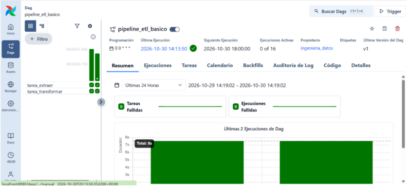
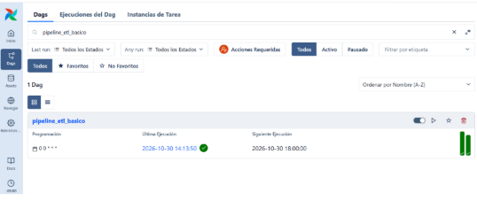

# Reporte: Orquestación de Flujos de Trabajo con Apache Airflow

## 1. ¿Qué es Apache Airflow?
Apache Airflow es una plataforma desarrollada para crear, planificar y monitorear flujos de trabajo programáticos. Permite a los desarrolladores definir tuberías de datos (pipelines) como código en Python, estructurándolas mediante **DAGs (Directed Acyclic Graphs)**. 

Sus componentes principales son:
* **Scheduler:** El motor que planifica y ejecuta las tareas en los nodos trabajadores (workers) basándose en dependencias predefinidas.
* **DAG:** La estructura lógica que define el orden de ejecución de las tareas sin permitir ciclos cerrados.
* **Interfaz de Usuario (UI):** Un panel visual que permite supervisar las ejecuciones en producción, solucionar problemas y revisar logs detallados.

## 2. Ejemplo Práctico: DAG de Extracción y Transformación (ETL)
A continuación, se presenta el código de un flujo de trabajo básico escrito para Airflow. Este DAG simula un proceso ETL donde una tarea extrae datos y, solo cuando esta termina exitosamente, se ejecuta la tarea de transformación.

**Código fuente (`mi_primer_dag.py`):**
```python
from airflow import DAG
from airflow.operators.python import PythonOperator
from datetime import datetime, timedelta


def extraer_datos():
    print("Conectando a la base de datos y extrayendo registros...")
    return "Datos extraídos"

def transformar_datos():
    print("Limpiando valores nulos y transformando la información...")
    return "Datos listos para análisis"


argumentos_por_defecto = {
    'owner': 'ingenieria_datos',
    'retries': 2, 
    'retry_delay': timedelta(minutes=1)
}

# 3. Definición del DAG (El Orquestador)
with DAG(
    dag_id='pipeline_etl_basico',
    default_args=argumentos_por_defecto,
    description='Un DAG simple de ETL de prueba',
    start_date=datetime(2023, 1, 1),
    schedule='@daily',
    catchup=False
) as dag:

    
    tarea_extraccion = PythonOperator(
        task_id='tarea_extraer',
        python_callable=extraer_datos
    )

    tarea_transformacion = PythonOperator(
        task_id='tarea_transformar',
        python_callable=transformar_datos
    )

   
    tarea_extraccion >> tarea_transformacion
```



